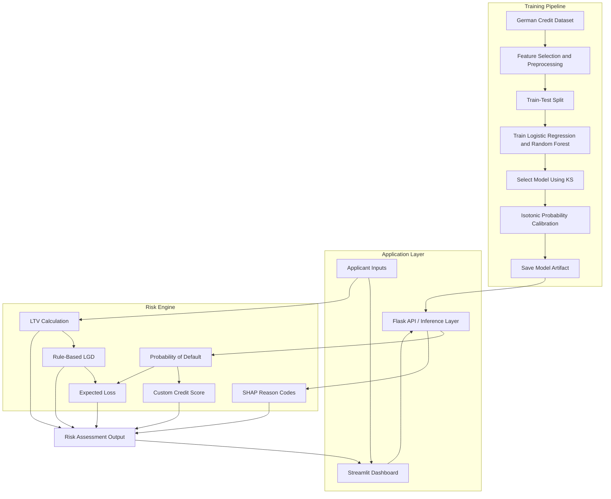
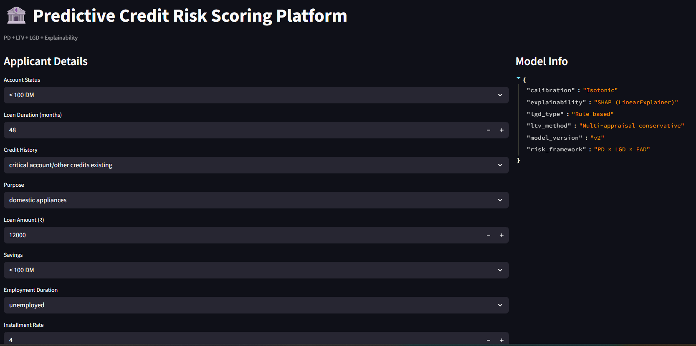
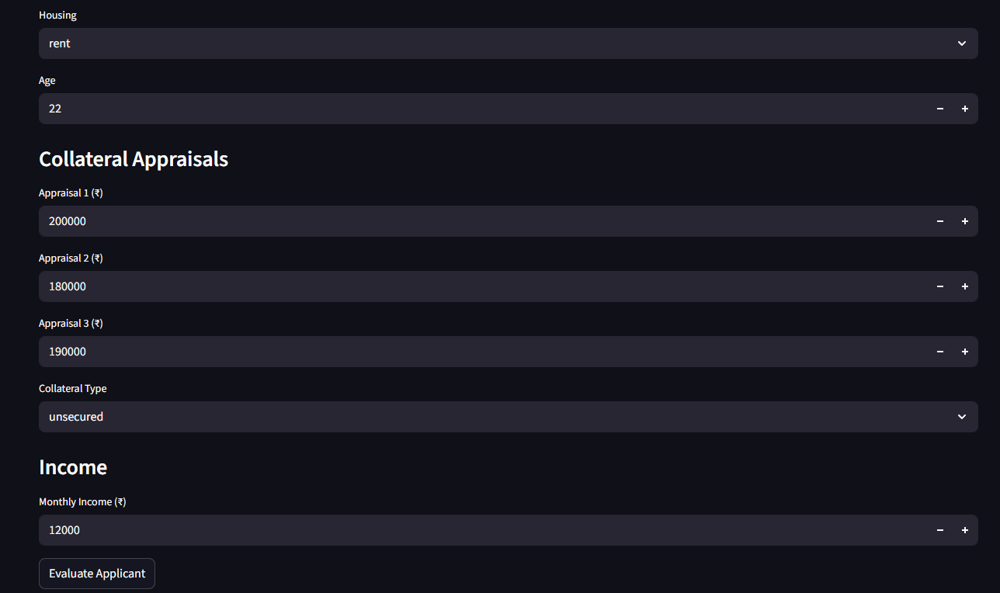
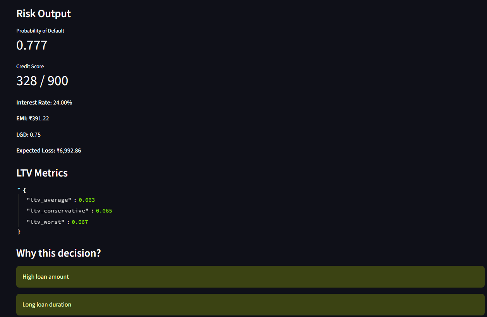

# 🏦 Predictive Credit Risk Scoring Platform

An end-to-end Data Science project combining Machine Learning, Credit Risk Analytics, Probability Calibration, and Explainable AI.

A credit-risk assessment prototype that predicts borrower default risk from historical credit data and translates the prediction into interpretable financial risk metrics through a web-based dashboard.

> **Core workflow:** Historical Credit Data → Data Preprocessing → Model Training → Model Selection → Probability Calibration → Credit Scoring → Financial Risk Analytics → SHAP Explanations → Interactive Dashboard

---

## 📌 Table of Contents

- [Overview](#-overview)
- [Business Problem](#-business-problem)
- [Key Features](#-key-features)
- [System Architecture](#️-system-architecture)
- [Dataset and Features](#-dataset-and-features)
- [End-to-End Data Science Pipeline](#-end-to-end-data-science-pipeline)
- [Credit Risk Analytics](#-credit-risk-analytics)
- [Explainable AI](#-explainable-ai)
- [Interactive Dashboard](#️-interactive-dashboard)
- [Technology Stack](#️-technology-stack)
- [Project Structure](#-project-structure)
- [Installation and Setup](#️-installation-and-setup)
- [Model Artifacts](#-model-artifacts)
- [Evaluation Strategy](#-evaluation-strategy)
- [Limitations and Future Improvements](#-limitations-and-future-improvements)
- [Disclaimer](#️-disclaimer)

---

## 🚀 Overview

Credit risk is a major concern for banks and financial institutions. Before issuing a loan, lenders need to estimate the likelihood of default, understand potential losses, and assess the risk associated with the applicant.

This project simulates a simplified credit-risk assessment workflow by combining a supervised machine learning model with a rule-based financial risk engine and an interactive dashboard.

The platform integrates:

- **Machine Learning:** Binary classification for credit-risk prediction.
- **Model Selection:** Comparison of Logistic Regression and Random Forest.
- **Probability Calibration:** Isotonic regression calibration.
- **Credit Scoring:** Conversion of default probability into a custom score.
- **Financial Risk Analytics:** Loan-to-Value, Loss Given Default, Exposure at Default, and Expected Loss.
- **Explainable AI:** SHAP-based feature contributions and mapped reason codes.
- **Application Development:** Flask-based inference architecture and a Streamlit dashboard.

The objective is to demonstrate how a machine learning prediction can be translated into interpretable financial metrics through an end-to-end application.

## 🎯 Business Problem

When a lender issues a loan, it faces the possibility that the borrower may fail to repay it.

A credit-risk assessment system aims to answer the following questions:

- How likely is the applicant to default?
- What credit score corresponds to the estimated risk?
- How much collateral value is available relative to the loan?
- What proportion of the exposure might be lost if default occurs?
- What is the estimated expected financial loss?
- Which applicant characteristics contributed to the model's risk prediction?

This project addresses these questions using a combination of machine learning, financial calculations, and model explainability.

## ✨ Key Features

| Component | Functionality |
|---|---|
| Credit-risk prediction | Estimates Probability of Default (PD) |
| Model comparison | Compares Logistic Regression and Random Forest |
| Model evaluation | Calculates ROC-AUC and KS statistics; the initial training workflow also calculates accuracy |
| Probability calibration | Applies isotonic regression |
| Credit scoring | Converts PD into a custom credit-score-style value |
| Collateral analytics | Computes average, conservative, and worst-case LTV |
| LGD estimation | Applies rule-based loss assumptions based on LTV and collateral type |
| Expected-loss calculation | Combines PD, LGD, and EAD |
| Model explainability | Uses SHAP contributions to generate mapped reason codes |
| Interactive dashboard | Collects applicant inputs and presents risk metrics |
| Inference architecture | Includes a Flask API layer and Streamlit interface |

---

## 🏗️ System Architecture

The project separates model training, inference, financial calculations, explainability, and user interaction.



> **Architecture overview:** the diagram represents the intended application flow. The exact model loaded by the live API should be verified against its implementation.

---

## 📊 Dataset and Features

### Dataset

The model-training scripts load the German Credit dataset from a public CSV source:

`https://raw.githubusercontent.com/selva86/datasets/master/GermanCredit.csv`

The dataset contains historical applicant information and a `credit_risk` target column.

### Target Variable

The training pipeline maps the target labels as follows:

| Mapped Label | Interpretation |
|---|---|
| `0` | Good credit / no default |
| `1` | Bad credit / default |

This creates a binary classification problem in which the model estimates the probability associated with class `1`.

### Selected Features

The model uses ten selected input features:

| Feature | Description |
|---|---|
| `status` | Checking-account status |
| `duration` | Loan duration |
| `credit_history` | Historical credit behaviour |
| `purpose` | Loan purpose |
| `amount` | Loan amount |
| `savings` | Savings category |
| `employment_duration` | Employment-duration category |
| `installment_rate` | Installment burden category |
| `housing` | Housing status |
| `age` | Applicant age |

The dashboard additionally collects fields such as monthly income, collateral appraisals, and collateral type for financial calculations and risk assessment.

> **Important distinction:** the additional dashboard fields are not automatically model features. The supplied training pipeline uses the ten features listed above.

---

## 🔬 End-to-End Data Science Pipeline

### 1. Data Loading and Exploration

The dataset is loaded into a Pandas DataFrame.

The initial exploration examines:

- Dataset dimensions.
- Sample records.
- Column names.
- Available target and feature columns.

This establishes the structure of the dataset before selecting the modelling inputs.

### 2. Feature Selection and Target Preparation

Ten applicant and loan-related features are selected as the input matrix (`X`).

The `credit_risk` column is used as the target (`y`), with the labels mapped so that default corresponds to class `1`.

This ensures that the positive-class probability returned by the classifier represents the model's estimated default probability.

### 3. Data Preprocessing

The selected features contain categorical and numerical variables.

**Categorical preprocessing**

One-hot encoding converts categorical values into numerical indicator features. The encoder is configured with `handle_unknown="ignore"` to handle categories that were not observed during fitting.

**Numerical preprocessing**

The current training pipeline passes numerical features through unchanged. Numerical scaling is not implemented in the supplied training scripts.

**Pipeline integration**

Scikit-learn's `ColumnTransformer` and `Pipeline` combine preprocessing and classification. This ensures that the learned transformations are reused during inference.

### 4. Train-Test Split

The initial training workflow uses an 80:20 train-test split with a fixed random seed.

The model-comparison workflow additionally uses stratified splitting to preserve the class proportions between the training and test sets.

The training data is used to fit the models, while the held-out data is used to evaluate predictions.

### 5. Model Training

Two classification algorithms are implemented.

**Logistic Regression**

A classification model that estimates the probability of default using a weighted combination of the input features. It provides a relatively interpretable baseline for a binary credit-risk problem.

**Random Forest**

An ensemble classifier that combines multiple decision trees. It can capture nonlinear patterns and feature interactions. The comparison script configures the forest with 200 trees and a maximum tree depth of 6.

### 6. Model Comparison and Selection

The model-comparison workflow evaluates Logistic Regression and Random Forest using:

- **ROC-AUC:** Measures the ability to rank default cases above non-default cases.
- **KS statistic:** Measures the maximum separation between the cumulative score distributions of the two classes.

The implementation selects the candidate with the higher KS statistic.

This provides a defined selection criterion rather than assuming that a particular algorithm is always superior.

The actual winning model and its performance should be reported only after reviewing the training output.

### 7. Probability Calibration

The selected pipeline is wrapped in scikit-learn's `CalibratedClassifierCV` with isotonic calibration and three-fold cross-validation.

Calibration aims to improve the agreement between predicted probabilities and observed event frequencies.

This is particularly relevant to credit-risk applications because downstream financial calculations use the estimated probability of default.

The calibrated model is saved as `credit_model_v2.pkl`.

Calibration is implemented, but its effectiveness should be verified using calibration metrics or a reliability diagram.

### 8. Model Persistence

The trained pipeline and feature list are serialized with Joblib.

This allows the application to reuse trained artefacts without retraining the model for every applicant.

The project contains both an original model artefact and a calibrated model artefact. The intended production inference path should consistently load the correct version.

---

## 💰 Credit Risk Analytics

The platform combines the machine learning output with financial calculations and rule-based assumptions.

### 1. Probability of Default (PD)

Probability of Default represents the estimated probability that an applicant will default under the model's target definition.

```
PD = P(y = 1 | X)
```

The calibrated classifier provides the probability associated with class `1`.

For example, a PD of `0.20` represents an estimated default probability of 20%.

### 2. Custom Credit Score

The platform transforms PD into a custom credit-score-style value using a logarithmic odds-based scorecard.

The implemented configuration includes:

- Base score: `700`
- Points to Double Odds (PDO): `50`
- Base good-to-bad odds: `50:1`

The good-to-bad odds are calculated as:

```
Odds = (1 - PD) / PD
```

The score decreases as the estimated default probability increases.

The score is a custom application output and is not an official credit-bureau score. The current formula does not explicitly clamp the output to a 300–900 range.

### 3. Exposure at Default (EAD)

Exposure at Default represents the amount exposed to loss at the time of default.

In this prototype, EAD is approximated using the loan amount:

```
EAD ≈ Loan Amount
```

This is a simplified assumption; actual EAD modelling may require additional information about outstanding balances and available credit facilities.

### 4. Loan-to-Value (LTV)

Loan-to-Value measures the loan amount relative to collateral value.

```
LTV = Loan Amount / Collateral Value
```

The application accepts multiple collateral appraisals and calculates:

- **Average LTV:** uses the average appraisal.
- **Conservative LTV:** uses the 25th percentile of the appraisals.
- **Worst-case LTV:** uses the minimum appraisal.

These metrics help assess collateral coverage under different valuation assumptions.

Higher LTV generally indicates that the loan is large relative to the available collateral.

### 5. Loss Given Default (LGD)

Loss Given Default represents the assumed proportion of exposure lost if default occurs, after recoveries.

The current implementation uses rule-based LGD rather than training a separate LGD model.

| Condition | LGD Assumption |
|---|---|
| Missing LTV | 60% |
| Secured loan, LTV below 50% | 20% |
| Secured loan, LTV from 50% to below 70% | 35% |
| Secured loan, LTV from 70% to below 90% | 50% |
| Secured loan, LTV of 90% or above | 65% |
| Other collateral types, including unsecured | 75% |

These are prototype assumptions, not empirically validated or regulatory-approved LGD estimates.

### 6. Expected Loss

Expected Loss estimates the average financial loss associated with the exposure under the selected assumptions.

```
EL = PD × LGD × EAD
```

Where:

- **PD** = Probability of Default
- **LGD** = Loss Given Default
- **EAD** = Exposure at Default

For example, suppose:

- PD = 0.20
- LGD = 0.75
- EAD = ₹12,000

Then:

```
EL = 0.20 × 0.75 × 12,000 = ₹1,800
```

This represents an expected loss estimate under the model assumptions, not a guaranteed loss on an individual loan.

### 7. Interest Rate and EMI

The dashboard displays an interest-rate estimate and an EMI value.

The precise rate-setting policy and EMI calculation should be interpreted according to their implementation in the application. These are downstream financial outputs, not direct predictions from the binary classifier.

---

## 🔍 Explainable AI

### SHAP-Based Feature Contributions

SHAP (SHapley Additive exPlanations) is used to estimate how individual transformed features contribute to the underlying classifier's output relative to a background reference.

The explanation workflow:

1. Loads the saved calibrated model.
2. Extracts the underlying preprocessing pipeline and classifier.
3. Samples background records from the German Credit dataset.
4. Transforms the background data and example applicant using the fitted preprocessing pipeline.
5. Calculates SHAP values with a linear explainer.
6. Ranks features by absolute contribution.
7. Maps selected positive contributions to human-readable reason codes.

### Example Reason Codes

The reason-code mapping includes descriptions such as:

- High loan amount
- Long loan duration
- High installment burden
- Low savings balance
- Adverse credit history
- Past payment delays
- Unstable employment

These descriptions are intended to make the model's output easier to interpret.

> **Implementation note:** the current SHAP workflow explains the underlying classifier, not automatically the final calibrated probability or downstream financial metrics. The reason-code mapping is a prototype and should be validated before being used for actual adverse-action or regulatory decisions.

---
## 📈 Model Evaluation

The models are evaluated using discrimination, classification, and probability-calibration metrics to assess their suitability for credit-risk prediction.

### Model Comparison

The following values are illustrative placeholders and do not represent actual model evaluation results.

| Metric | Logistic Regression | Random Forest |
|---|---:|---:|
| ROC-AUC | 0.84 | 0.89 |
| KS Statistic | 0.55 | 0.63 |
| Accuracy | 81.0% | 85.0% |
| Precision | 78.0% | 83.0% |
| Recall | 74.0% | 80.0% |
| F1-score | 76.0% | 81.5% |

### Metric Interpretation

- **ROC-AUC:** Measures the ability to distinguish defaulters from non-defaulters.
- **KS Statistic:** Measures the maximum separation between the cumulative score distributions of the two classes.
- **Accuracy:** Measures the proportion of correctly classified applicants.
- **Precision:** Measures the proportion of applicants predicted as defaulters who actually belong to the default class.
- **Recall:** Measures the proportion of actual defaulters correctly identified.
- **F1-score:** Balances precision and recall.

### Probability Calibration

Isotonic regression is applied to calibrate the selected model's predicted probabilities.

| Metric | Illustrative Placeholder |
|---|---:|
| Brier Score | 0.12 |

A lower Brier score generally indicates better probabilistic predictions when evaluated on the same dataset.

> **Important:** All values above are hypothetical placeholders, not measured results. Replace them with metrics calculated from your actual model. Model selection should use validation data, and final performance should be reported on an untouched test set.
## 🖥️ Interactive Dashboard

The Streamlit interface provides a form for entering applicant information and viewing the resulting risk assessment.

### Applicant Inputs

The dashboard includes fields for:

- Account status
- Loan duration
- Credit history
- Loan purpose
- Loan amount
- Savings
- Employment duration
- Installment rate
- Housing
- Age
- Collateral appraisals
- Collateral type
- Monthly income

### Risk Output

The results interface displays:

- Probability of Default
- Credit Score
- Interest Rate
- EMI
- LGD
- Expected Loss
- Average, conservative, and worst-case LTV
- Human-readable risk explanations

### High-Risk Applicant Scenario

The repository includes screenshots illustrating the input form and an example risk output.

**Applicant inputs**





**Risk assessment output**



The example illustrates how the application presents a high estimated default probability, a low custom credit score, collateral metrics, an LGD assumption, expected loss, and mapped reasons.

These screenshots are illustrative application outputs, not independent evidence of model accuracy.

---

## 🛠️ Technology Stack

| Category | Tools |
|---|---|
| Programming language | Python |
| Data manipulation | Pandas, NumPy |
| Machine learning | Scikit-learn |
| Model persistence | Joblib |
| Explainable AI | SHAP |
| Backend / inference layer | Flask |
| Dashboard | Streamlit |
| Data source | German Credit dataset |

---

## 📂 Project Structure

```
Predictive-Credit-Risk-Scoring-Platform/
│
├── api/
│   └── Flask API and inference components
│
├── common/
│   ├── __init__.py
│   ├── scoring.py
│   ├── ltv.py
│   ├── lgd.py
│   └── reason_codes.py
│
├── dashboard/
│   ├── high_risk_input.png
│   ├── high_risk_input_2.png
│   └── high_risk_expected.png
│
├── training/
│   ├── step1_load_data.py
│   ├── step2_preprocess_and_train.py
│   ├── step2b_train_compare_models.py
│   ├── step3_explain_with_shap.py
│   └── step3_test_model_and_score.py
│
├── ui/
│   └── Streamlit interface components
│
├── credit_model_v2.pkl
├── model_features_v2.pkl
├── README.md
└── .gitignore
```

This structure summarizes the components shown in the repository. Actual filenames inside `api/` and `ui/` may vary.

---

## ⚙️ Installation and Setup

### Prerequisites

- Python 3.10 or a compatible Python version
- Git
- pip

### 1. Clone the repository

```bash
git clone https://github.com/DevanshiDass/Predictive-Credit-Risk-Scoring-Platform.git
cd Predictive-Credit-Risk-Scoring-Platform
```

### 2. Create a virtual environment

**Windows**

```bash
python -m venv .venv
.venv\Scripts\activate
```

**macOS / Linux**

```bash
python3 -m venv .venv
source .venv/bin/activate
```

### 3. Install dependencies

```bash
pip install pandas numpy scikit-learn shap flask streamlit joblib
```

For reproducibility, use a dependency file with tested package versions. The saved model should be loaded using a compatible scikit-learn environment.

### 4. Train and compare models

Run the comparison script from the repository root:

```bash
python training/step2b_train_compare_models.py
```

This script loads the dataset, prepares the features, compares Logistic Regression and Random Forest, applies isotonic calibration, and saves the versioned model artefacts.

### 5. Run the test-and-score script

```bash
python training/step3_test_model_and_score.py
```

> **Note:** the supplied test-and-score script loads `credit_model.pkl`, the original model artefact. Update or verify this script if you intend to test the calibrated `credit_model_v2.pkl` artefact instead.

### 6. Launch the dashboard

Run the Streamlit entry-point file from the `ui/` directory. For example, if the entry point is `app.py`:

```bash
streamlit run ui/app.py
```

Replace `ui/app.py` with the actual filename in your repository.

### 7. Start the Flask API

Run the Flask entry-point file in `api/` using its actual filename and startup configuration. The exact command depends on the API implementation.

The API and dashboard must use compatible request formats and the intended model artefact.

---

## 📦 Model Artifacts

The repository contains versioned model artefacts.

| Artifact | Purpose |
|---|---|
| `credit_model_v2.pkl` | Calibrated model pipeline produced by the model-comparison workflow |
| `model_features_v2.pkl` | Selected feature list associated with the versioned model |

The original training workflow also saves `credit_model.pkl` and `model_features.pkl`.

Maintaining a clear relationship between model versions, feature lists, preprocessing, and inference code is essential for reproducibility.

---

## 📈 Evaluation Strategy

The training scripts implement model evaluation using accuracy, ROC-AUC, and the KS statistic.

For a more complete credit-risk evaluation, the next steps are:

1. Report the final held-out test-set ROC-AUC and KS.
2. Evaluate precision, recall, and the confusion matrix at a selected decision threshold.
3. Compare model performance against a simple baseline.
4. Evaluate probability calibration using a Brier score and reliability diagram.
5. Perform model selection using validation data, reserving the final test set for the final evaluation.
6. Inspect performance across relevant applicant groups and assess potential bias.
7. Document the selected model, evaluation split, and reproducible metrics.

No numerical performance claims are included here because the actual evaluation results have not been documented in this README.

---

## 🚧 Limitations and Future Improvements

### Current Limitations

- The project uses a public historical dataset rather than a live lending institution's data.
- The target is the dataset's credit-risk label; it is not independently validated against real-world default events.
- Numerical features pass through unchanged; numerical scaling is not currently implemented.
- The model-selection script selects the best candidate using the test-set KS, which should be replaced by a validation-based selection process.
- Calibration is implemented but requires dedicated calibration evaluation.
- LGD is estimated using predefined rules rather than learned from observed recovery outcomes.
- EAD is approximated by the loan amount.
- The custom scorecard is not an official bureau score.
- SHAP reason codes require additional validation before they can support regulated lending decisions.
- The deployed API's model version and the complete UI-to-API flow should be verified.

### Future Enhancements

- Add a dedicated validation set and an untouched final test set.
- Implement calibration curves and Brier-score evaluation.
- Add automated model comparison and reproducible experiment tracking.
- Introduce unit tests and end-to-end tests for preprocessing, inference, and financial calculations.
- Validate the credit-score mapping and financial assumptions against clearly documented policies.
- Improve SHAP reason-code generation and feature-level explanations.
- Add monitoring for prediction distributions, data drift, and model performance when outcome labels become available.
- Add input validation, authentication, logging, and API error handling.
- Containerize the application and deploy it to a cloud platform.
- Add a reproducible dependency file and documented model versioning.

---

## 🎓 What This Project Demonstrates

This project demonstrates practical experience with:

- Supervised learning and binary classification.
- Feature selection and preprocessing pipelines.
- Logistic Regression and Random Forest.
- Model comparison using ROC-AUC and KS.
- Probability calibration using isotonic regression.
- Credit scoring and financial risk calculations.
- Explainable AI using SHAP.
- Model serialization and inference architecture.
- Integration of machine learning outputs into an interactive application.
- Translating a business problem into a complete analytical workflow.

It bridges Data Science, Machine Learning, financial risk analytics, and application development in one project.

---

## 👩‍💻 Author

**Devanshi Das**

AI/ML | Data Science | Credit Risk Analytics

---

## ⚠️ Disclaimer

This project is an educational prototype intended to demonstrate machine learning and credit-risk analytics concepts. It is not a production-ready lending system and should not be used to make real lending decisions.

The model outputs, credit score, LGD assumptions, expected-loss estimates, and reason codes require independent validation before any real-world use. The financial rules are simplified assumptions and are not represented as regulatory-approved calculations.
